# Photoshop plugins

This repo holds Ditherkit, a dithering and halftone panel for Photoshop, along with the design system and image engine it's built on. More plugins will live here later and share the same pieces.

<p>
  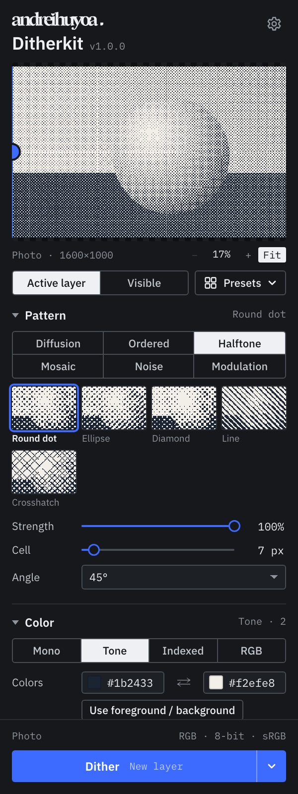
  &nbsp;
  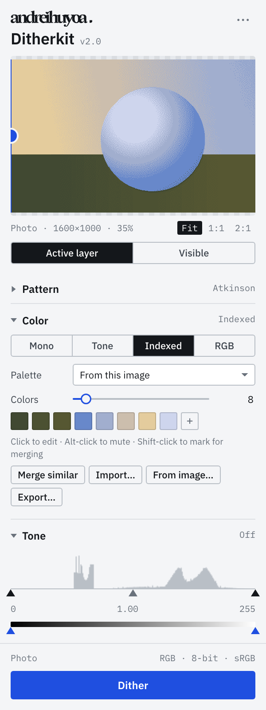
</p>

## Ditherkit

Photoshop's built-in Bitmap mode takes a dozen steps, flattens your file, and gives you a handful of patterns. Ditherkit does it from one panel and keeps your layers intact. You pick a pattern, adjust it against a live preview, and press Dither. The result appears on the canvas and updates as you keep adjusting. Save keeps it; Cancel removes it.

| | | | |
| :-: | :-: | :-: | :-: |
|  |  | 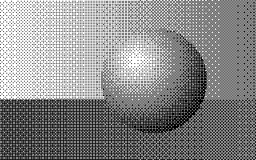 | 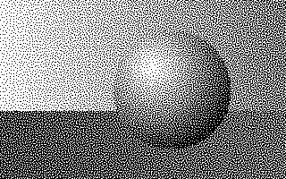 |
| Floyd–Steinberg | Atkinson | Bayer 8×8 | Blue noise |
| 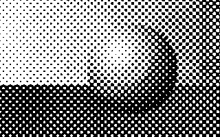 | 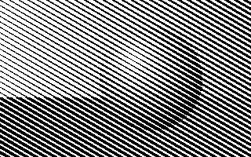 | 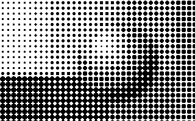 | 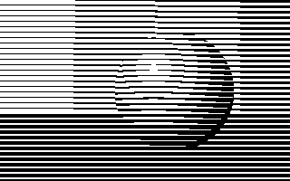 |
| Halftone, round dot | Halftone, line | Mosaic | H beam |
| 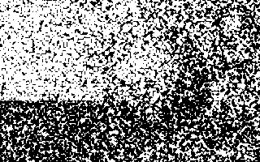 | 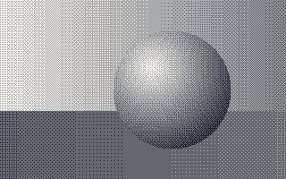 | 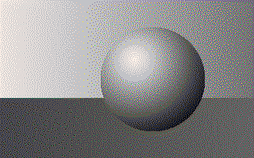 | 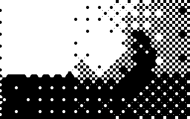 |
| Xerox grain | Four-step tone ramp | PICO-8 palette | Rounded edges |

### What it can do

- **31 patterns** in six groups: error diffusion (Floyd–Steinberg, Atkinson, Jarvis, Stucki, Sierra and others), ordered (Bayer, clustered), halftone (dot, ellipse, diamond, line, crosshatch at any angle), mosaic, noise (blue noise, Xerox grain) and modulation (scan lines that bend with brightness). Each one has a thumbnail rendered from your own image.
- **Color modes:**
  - Mono, and tone ramps between any two colors (including your foreground and background colors).
  - Indexed palettes: built-in ones, colors pulled from the image, or your own. You can import Adobe `.ase` / `.aco` and GIMP `.gpl` files, and export `.gpl`.
  - RGB with a set number of levels per channel.
- **Tone controls:** a Levels control with five handles over the image's histogram, plus blur, sharpen, denoise and invert.
- **Scale and edges:** chunky pixels, print-resolution sizing, and crisp, soft or rounded edges.
- **Output:** a new layer, a replacement for the source (the original stays, hidden), one masked fill layer per color, a layer mask, a new document, or a PNG.
- **Batch:** dither every selected layer with the same settings.
- **Document check:** warns about CMYK, 16-bit or non-sRGB documents and converts them in one click.
- **Presets** you can save, import and export.
- **Two themes:** the panel's own Instrument look, light or dark to match Photoshop, or Photoshop's native look. Switch in the panel menu.

### Install

There's no packaged release yet, so for now you build it yourself. You need Node.js 22.18 or newer, [pnpm](https://pnpm.io), Photoshop 2024 (25.0) or newer, and Adobe's UXP Developer Tools (install it from the Creative Cloud app).

```bash
git clone https://github.com/andreihuyoa/photoshop-plugins.git
cd photoshop-plugins
pnpm install
pnpm build
```

Then load it:

1. In Photoshop, go to *Settings › Plugins*, turn on **Enable Developer Mode**, and restart Photoshop.
2. In UXP Developer Tools, click **Add Plugin** and choose `ditherkit/dist/manifest.json`.
3. Click **Load**. The panel appears under *Plugins › Ditherkit*.

To install it permanently instead, run `pnpm --filter ditherkit ccx` and double-click the `.ccx` file it creates in `ditherkit/ccx/`.

### Using it

1. Select a layer, or switch the source to **Visible** to use everything you can see.
2. Pick a pattern and color mode. The preview at the top updates as you go. Drag the line across it to compare with the original. Scroll over the preview to zoom, drag to move around, and click a spot to see it at 100%.
3. Choose what the result should become with the arrow on the **Dither** button: a new layer, a replacement for the source, color layers, a layer mask, a new document or a PNG. The button shows your choice.
4. Press **Dither** (or Enter). The result appears on the canvas and keeps updating while you adjust.
5. Press **Save** (Enter) to keep it, or **Cancel** (Esc) to remove it.

The whole edit is one step in Photoshop's history, so a single undo removes it.

See the [changelog](ditherkit/CHANGELOG.md) for what changed in each version.

### Status

Ditherkit is developed on Photoshop 2026 for macOS. Windows hasn't been tested yet. The document needs to be RGB at 8 bits per channel; the document check converts it for you if it isn't. Ditherkit doesn't render video frames yet, so batch works on selected layers only.

## What's in the repo

| Folder | What it is |
| --- | --- |
| [`ditherkit`](ditherkit) | The Photoshop plugin, built with [Bolt UXP](https://github.com/hyperbrew/bolt-uxp), React and a webview UI |
| [`packages/workbench`](packages/workbench) | The design system every plugin here uses: themes, React components and layout rules |
| [`packages/dither-engine`](packages/dither-engine) | The dithering, palette and image code. Plain TypeScript with no Photoshop dependencies, so it runs and is tested in Node |

## Development

```bash
pnpm dev        # rebuild on change and reload the plugin in Photoshop
pnpm harness    # run the panel in a browser against a fake Photoshop (localhost:5181)
pnpm test       # engine tests
pnpm typecheck  # all packages
```

When using `pnpm dev`, load the plugin in UXP Developer Tools with **Load**, not **Load & Watch**; Bolt UXP handles reloading itself.

The engine runs inside Photoshop's plugin runtime, next to the pixel APIs. The panel is a webview that only receives small PNG previews and numbers, so full-size images never pass between the two.

## Credits

- [Bolt UXP](https://github.com/hyperbrew/bolt-uxp) by Hyper Brew for the plugin build setup.
- [IBM Plex](https://github.com/IBM/plex), used under the SIL Open Font License.
- The algorithms come from published work: Floyd and Steinberg (1976), Jarvis, Judice and Ninke (1976), Stucki (1981), Bill Atkinson's dithering for the original Macintosh, Frankie Sierra's filters, Shiau and Fan (1996), and Ulichney's void-and-cluster method (1993) for blue noise.

## License

[MIT](LICENSE)
